# hwBro

**A native reconstruction of BroPlus 3.00 - the old DOS xBase database manager - merged with a two-panel
file manager in the spirit of Norton Commander and Total Commander.**

`hwBro` runs as a single Windows executable: a text-mode screen (DOS look, no emulator, no console) with a
Harbour/xBase engine underneath. It opens the databases and the index files of the original, browses and
edits records, and at the same time works as a full file manager: two panels, copy/move/delete, a multi-tab
editor, a hex viewer, zip archives you can browse like folders and a TCP/IP link between two machines.

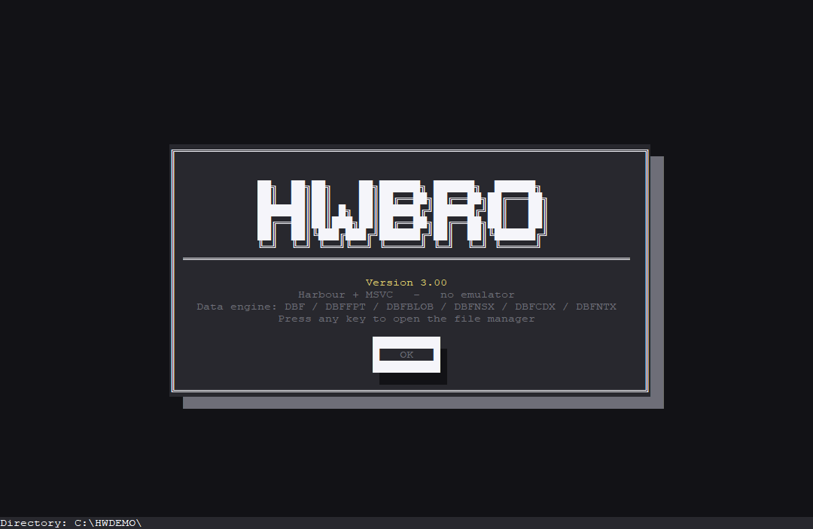

---

## Background

**BroPlus 3.00** (Extrasensory Software) was a 16-bit DOS xBase application: CA-Clipper 5.2, the SIx Driver
index engine and the CauseWay extender. `hwBro` is a from-scratch reconstruction of it in **Harbour 3.2**,
compiled with **MSVC 2019 x64** and painted with the **GTWVG** text-mode driver: the result is a Win32 window
that looks like the DOS screen of the original.

The project is based on three things: **BroPlus 3.00**, the DOS database manager it reconstructs;
**Norton Commander** and **Total Commander**, whose two-panel file manager is the model of the start screen.

The colours were measured pixel by pixel on the original program; the canvas, on the other hand, was
**redesigned to 120x44 characters** instead of the historical 80x25, so every screen is laid out for the
bigger grid. The classic `F1..F9` menu bar, the green/red record bands and the cyan status bars are all
there.

This is not a byte-for-byte clone of the DOS binary. The goal is **the same functionality**, extended with
things the original never had: zip browsing, directory synchronization, a multi-tab editor with syntax
highlighting, a hex viewer, a TCP/IP "Commander Link" between two instances, themes and full mouse support.

All the screenshots in this document were taken on a **synthetic demo folder** (`C:\HWDEMO`) with invented
names and amounts - no real data appears anywhere.

---

## Two tools in one program

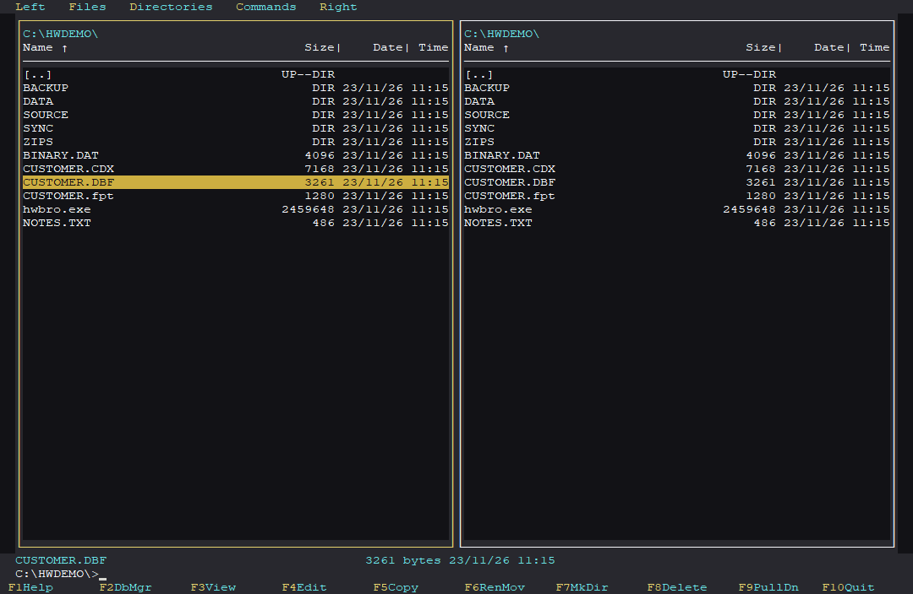

The program starts in the **Harbour Commander**: a Norton/Total Commander style two-panel file manager
(directories first, then files, sortable by clicking the column headers, marks with `Ins`/`+`/`-`/`*`,
`F3` view, `F4` edit, `F5` copy, `F6` rename/move, `F7` make directory, `F8` delete, `F9` pull-down menu).
`Enter` on a `*.DBF` opens it in the **DB manager**, the reconstructed BroPlus itself; `F2` opens the DB
manager too (on a `*.DBF` it opens that database, on anything else it opens with no database loaded).

---

## 1. Commander Link

Two `hwBro` instances can share a panel over TCP/IP on the LAN. One works as **Slave** and serves a
directory (the whole disk, or just the folder of the active panel); the other works as **Master** and mounts
that directory in one of its panels: it browses it, and `F5`/`F6`/`F7`/`F8` copy, move, create and delete
**real files on the other machine**.

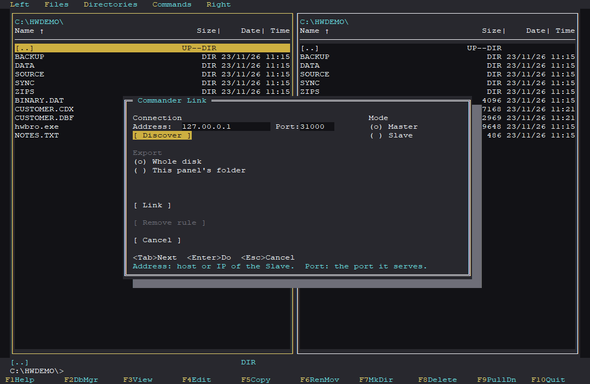

- The Slave can be found automatically: `Discover` broadcasts on the LAN and lists the peers that answer.
- Paths on the remote panel are absolute paths of the peer, shown as `\\PEER\C:\...`, so they can never be
  confused with a local path.
- Transfers are atomic on both ends (`<name>.$$$` + rename).
- Security is deliberately minimal, as requested when it was designed: **no authentication and no
  encryption**. A Slave left serving `Whole disk` gives read/write access to that machine to anybody who
  reaches the port. Choose `This panel's folder` to confine it to one subtree.
- On first use Windows Firewall may block the incoming connections; the Slave detects it and offers to add
  the two inbound rules (that step needs the UAC prompt).

---

## 2. Zip support

`Enter` on a `*.zip` opens the archive **as if it were a directory**, with a virtual path in the title
(`C:\...\ARCHIVE.ZIP`):

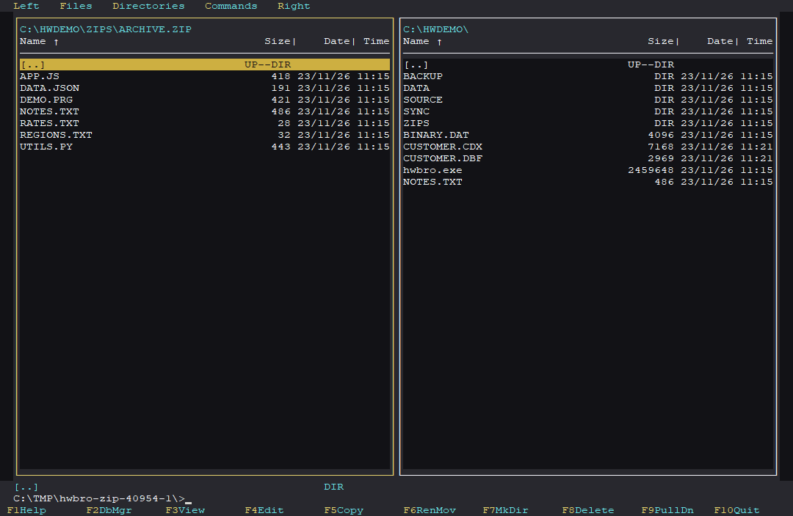

Because it behaves like a folder, everything the panels do works inside the archive: copy files in and out,
rename, delete, make directories, `F3`/`F4` on an entry, marks, sorting, the context menu... After each
change the archive is rewritten atomically (a `.$$$` copy replaces the original, which is kept as a backup
while the rewrite runs). Password-protected archives are supported (the password stays in memory for the
session). A zip inside a zip opens a second session on top of the first.

---

## 3. The editor

`F4` opens a text editor with **tabs**, so several files can stay open at once:

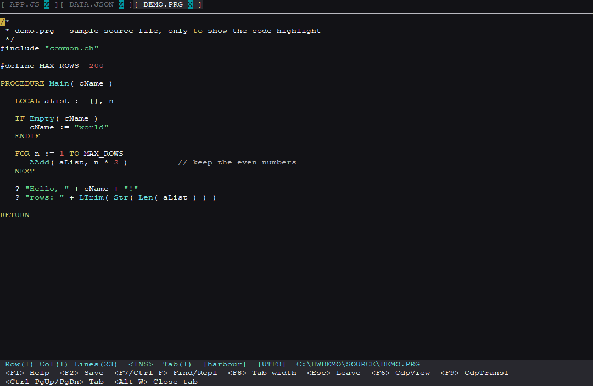

- `Ctrl-PgUp` / `Ctrl-PgDn` walk the tabs, `Alt-W` closes the active one, a click activates a tab and a click
  on its `X` closes it. A tab whose buffer differs from the last saved text shows a red `X`.
- `F2` (or `Ctrl-S`) saves, `Esc` leaves and asks only when something changed. **Undo/redo is unlimited**
  (`Ctrl-Z` / `Ctrl-Shift-Z`), `Ctrl-G` goes to a line.
- `F7`/`Ctrl-F` opens the **Find / Replace** box: literal, whole words, **regular expressions (PCRE)**,
  case sensitive, backwards, in selection or in the whole document, with `$1..$9` and `&` in the
  replacement.
- `Shift+arrows` select, `Ctrl-C`/`Ctrl-X`/`Ctrl-V` use the Windows clipboard.
- The **tab width is detected** from the file (and can be changed with `F8`), and the status row shows the
  language, the codepage, the tab width and the mode.
- `F6` previews the file with another codepage without touching it; `F9` converts the buffer (UTF-8, CP850,
  Windows-1252, ISO-8859-1...).
- `Alt-P` **pretty-prints a JSON or an XML** document: in the viewer it only changes what you see, in the
  editor it becomes the buffer and one `Ctrl-Z` reverts it.

### Syntax highlighting

Sources are colourised by language, detected from the extension: Harbour/Clipper (`.prg .ch .hb`), Python,
C, C++, JavaScript/JSON, SQL and batch files. Keywords, strings, comments, numbers, function names and
preprocessor lines each get their own colour, on the same dark body of the screen (no new RGB: the palette
is the one measured on the original DOS program).

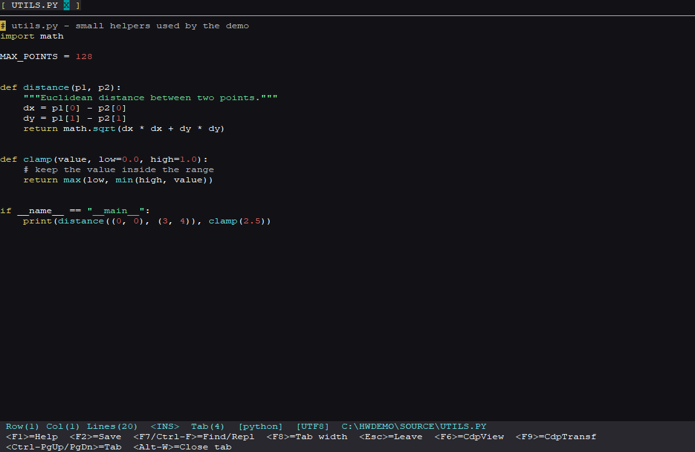

### Hex viewer

`F3` on a binary file opens a classic **hex dump** instead of the text viewer: offset column, hex bytes and
the ASCII column, with as many bytes per row as the canvas allows.

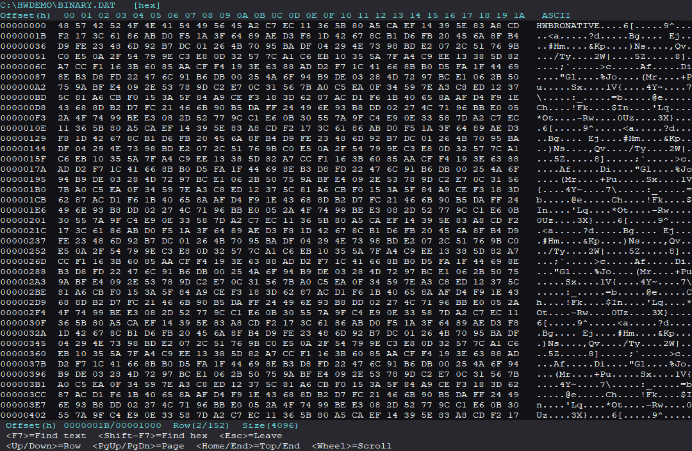

`F7` searches text and `Shift-F7` searches bytes (`EB 52 90`, `EB5290` and `EB-52-90` are all valid); the hit
is highlighted in the hex block **and** in the ASCII column. The file is opened read-only and never written.

---

## 4. Synchronize directories

`Directories > Synchronize directories...` compares the two panels and shows, side by side, what differs.
`F4` runs the comparison, `F5` does the job:

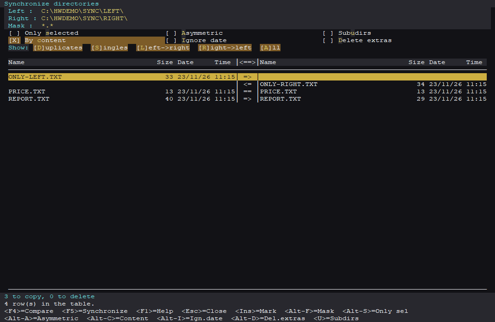

- The pair criterion is name, then size, date and (optionally) content: `By content` reads the two files and
  marks identical rows with `==`, so they are listed but never copied.
- Each row shows its direction (`=>` left to right, `<=` right to left); the summary says how many files
  would be copied and how many deleted.
- `Asymmetric`, `Ignore date`, `Delete extras`, `Only selected`, a file mask and the `Show:` filters
  (`Duplicates`, `Singles`, direction...) narrow what the table lists and what `Synchronize` does.
- Existing destinations are asked one by one with the seven-button overwrite box
  (`Replace`, `Replace All`, `Skip`, `Skip All`, `Cancel`, `Replace Older`, `Rename`).

---

## 5. Search and replace across files

`Files > Search and Replace` (`Ctrl-F` in the panels) is a proper form with **its own replace**, not a
recycled editor dialog:

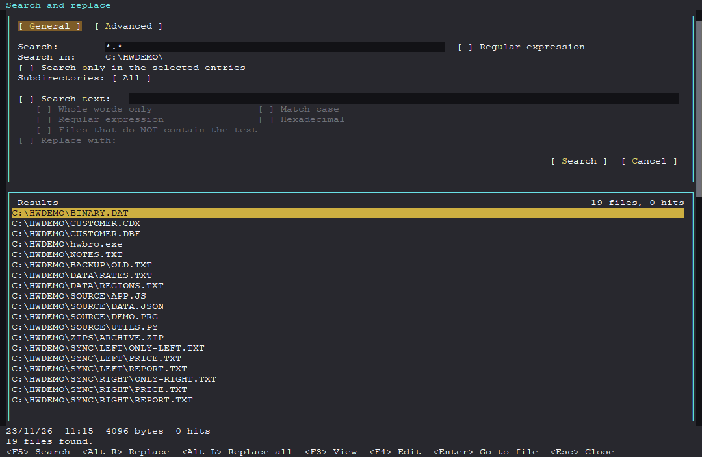

- File mask, `Search in:` the active panel, `Subdirectories: All/None`, `Only the selected entries`.
- `Search text` with `Match case`, `Whole words only`, `Regular expression`, `Hexadecimal`, and the useful
  `Files that do NOT contain the text` filter.
- `Replace with` turns it into a search-and-replace over the whole tree; each result row has a **checkbox**,
  so only the rows you leave marked are written (`Ins`/`Space` toggles the current one, `Alt-I` inverts all).
- The results list is the file list: `F3` views, `F4` edits, `Enter` jumps to the file, `Alt-R` replaces the
  current row, `Alt-L` replaces every marked one. The write is atomic per file.

---

## 6. The DB manager (BroPlus itself)

This is the reconstructed BroPlus: record screens, the classic `F1..F9` menus and a dot prompt.

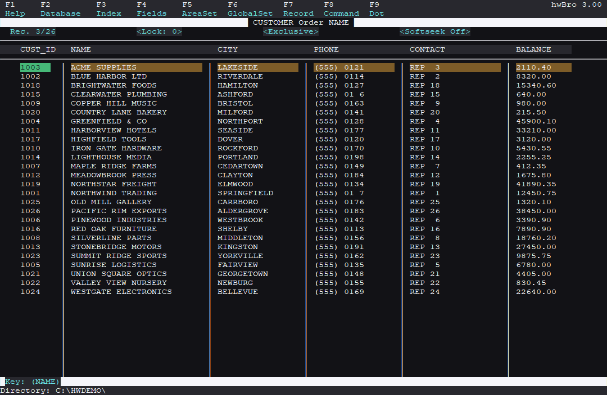

- **Engines**: `DBFCDX` (`.DBF/.CDX/.FPT`) - it reads the `.CDX` files generated by the SIx Driver of the
  original program - and `DBFNTX` (`.DBF/.NTX/.DBT`).
- **Browse edit** is the record grid: `Up`/`Down`/`PgUp`/`PgDn`, `Ctrl-PgUp`/`Ctrl-PgDn` to the first/last
  record, `Ctrl-Home`/`Ctrl-End` to the first/last column, `Enter` edits the cell **in place** with the mask
  of the field (dates follow the selected `Date Format`), `Ins` appends, `Del` deletes/recalls, `Esc` closes
  the database and returns to the file manager. The cursor cell is green, the current record band is red, a
  deleted record is dimmed and flagged in the status row.
- **Mouse**: wheel, click to a cell, double click to edit, selection with `Shift`, clipboard chords and two
  context menus (record and text).
- **Browse view** (`F3` on a `*.DBF` in the panels) is the same grid in read-only mode.

The menus keep the texts of the original dump:

| Key | Menu | What it does |
|---|---|---|
| `F1` | Help | keys of the current screen |
| `F2` | Database | selection screen, next/previous, close, open mode (shared/exclusive), alias name, create/modify structure, generate structure `.PRG`, file spec, change directory, shell |
| `F3` | Index | index file selection, scope top/bottom, dynamic options (unique, descending), create index file, recreate index file, tag selection/information |
| `F4` | Fields | field selection, column options, structure |
| `F5` | AreaSet | filters, relations, memo width, work areas, views |
| `F6` | GlobalSet | driver, `Date Format` (the 14 layouts of the original), `Epoch`, cell edit, protected, hide deleted, softseek, themes, directories |
| `F7` | Record | seek, goto, locate, skip, go top/bottom, append, delete/recall, copy/paste field, copy/paste record, view clipboard |
| `F8` | Command | `Append From`, `Copy To`, `Replace`, `Count`, `List to Print`, `Sum/Average`, `Pack`, `Reindex`, `Zap` |
| `F9` | Dot | xBase dot prompt |

Every menu row announces its **global accelerator** and it works from anywhere in the screen:

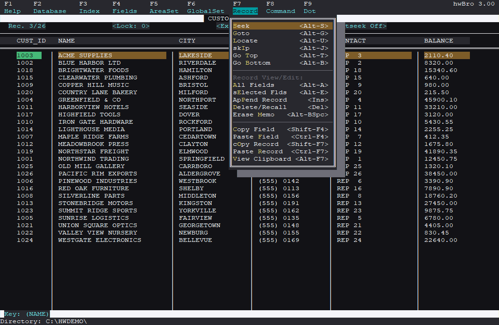

Data-entry screens follow one visual language (one focus ring, one focus colour, an `Alt+<letter>` quick key
inside every label, mouse on every control): `Replace`, `Append From` (with its own file picker), `List to
Print`, `Sum/Average`, the file search and the editor's Find/Replace all belong to it.

### Structure editor

`F2 > Create/Modify Structure` is the field editor of the original: columns, `Ins`/`Del` for rows,
`Enter`/typing to edit, `Alt-M` to write the new structure **copying the data by field name**, `Alt-E` to
create an empty database, `Alt-P` to print or save the listing.

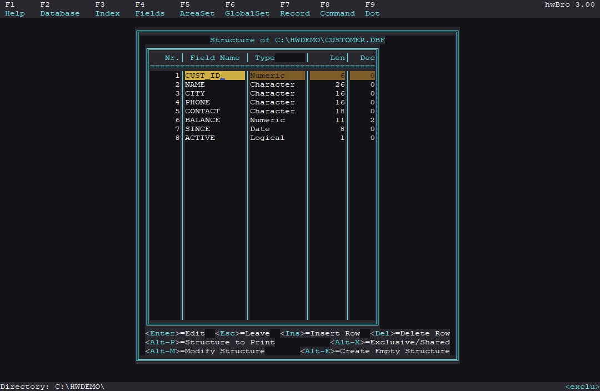

When the structure is applied it analyses the indexes first: if no key expression changed, **no index file
is touched**; if a key did change, it asks order by order whether to rebuild it, and a tag whose field was
removed is dropped. Any failure puts the previous index file back byte for byte.

### Dot prompt

`F9` drops to an xBase dot prompt with command history, scrollable output and the live status of the work
area:

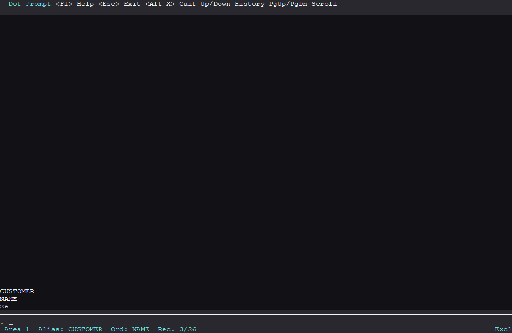

```
? ALIAS()
? ORDNAME()
? RECCOUNT()
```

`SELECT`, `USE`, `INDEX ON`, `SET ORDER`, `GO TOP/BOTTOM`, `SKIP`, `COUNT`, `APPEND BLANK`, `REPLACE`,
`DELETE`/`RECALL`, `PACK`, `ZAP`... Destructive commands ask in the input line itself. `Esc`/`EXIT` go back
to the program, `QUIT` exits.

---

## 7. More

- **Compare two files** (`Shift-F2`, or `Files > Compare`): line-by-line split view with the changed
  segments highlighted, difference navigation (`F7`/`F8`), `Only differences`, ignore case/whitespace,
  unified view (`Ctrl-O`).

  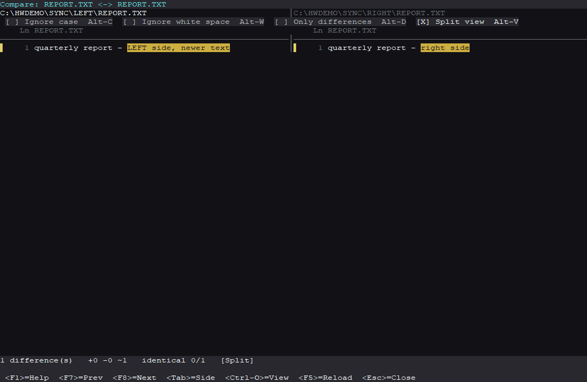

- **Tree panel** (`Left/Right > Tree panel`): the folder tree of the current drive, with lazy loading; the
  other panel follows the cursor.
- **File attributes**: read/write the DOS `R/A/H/S` bits and the timestamp of the selection, recursively if
  asked, through fixed date/time masks.
- **Safe delete**: `Del`/`F8` send files to the Windows **Recycle Bin**; `Shift-Del` deletes permanently.
- **Clipboard as files**: `Ctrl-C` in a panel puts the real files (`CF_HDROP`) on the Windows clipboard, so
  `Ctrl-V` in Explorer copies them; `Ctrl-V` in a panel pastes the list back.
- **Themes**: `Classic` (the colours measured on the original) and `Dark`.
- **Keyboard and mouse everywhere**: every checkbox, field, button and chip can be clicked, because each
  control is registered when it is painted and the click produces the very same key the keyboard would.

---

## Building

Requirements:

- **Harbour 3.2** in `C:\harbour` (the build script looks for `C:\harbour\bin\hbmk2.exe`).
- **Microsoft Visual C++ 2019** with `vcvarsall.bat x86_amd64` (the script tries the `Community` edition
  path; any edition works if that path is adjusted).
- The Harbour contrib packages used by the project are requested inside `src\hwbro.hbp`
  (`hbziparc.hbc`, `hbwin.hbc`).

```bat
build.bat
```

The script is self-contained: it loads the MSVC environment itself, sets `HB_COMPILER=msvc64`, deletes the
previous binary and runs `hbmk2 src\hwbro.hbp`. The output is **`hwbro.exe` in the project root**.

Exit codes: `0` built, `1` build failed, `2` toolchain missing, `3` a running `hwbro.exe` holds the old
binary (close the program before rebuilding).

**This project compiles with MSVC.** Other compilers are not supported and the binary they produce is not the
one this program is tested with.

### Running it

Start `hwbro.exe` from the folder that holds your `.DBF` files (the working directory is the data
directory), or drag a `*.DBF` onto the executable to open it directly in the DB manager.

---

## Project layout

| File | Contents |
|---|---|
| `src/hwbro.prg` | start-up, splash, `F1..F9` menu bar, error log |
| `src/bp_hc.prg` | the Harbour Commander: panels, menus, viewer, editor, zip, tree, compare, sync, Commander Link UI |
| `src/bp_core.prg` | work areas, opening databases, record browser |
| `src/bp_cmds.prg` | the actions behind every menu option |
| `src/bp_struct.prg` | structure copy (`StructApply()`), validation, index rebuild |
| `src/bp_dot.prg` | the dot prompt |
| `src/bp_link.prg` | Commander Link transport and protocol (sockets, all in PRG) |
| `src/bp_ui.prg` | screen toolkit: frames, dialogs, line editor, list picker, themes |
| `src/bp_def.ch` | colours, constants, common includes |
| `src/bp_win32.c` | native helpers: window hook (mouse, clipboard, close button), registration dump |
| `src/hwbro.hbp` | the `hbmk2` project (GTWVG, output `..\hwbro.exe`) |
| `build.bat` | the build script |

---

## Porting, forking, contributing

The project is **Windows x64 and MSVC specific**: the build script, the text driver (GTWVG) and the native
helpers in `src/bp_win32.c` (window hook, clipboard, file timestamps, firewall) are Windows code.

If you want to run it on **Linux**, the sensible way is a **fork**: replace the GT driver with a portable one
(or the GTK build of GTWVG), adapt or stub the native helpers and adjust the build script. Same for any extra
feature or bug fix you want: fork it, adapt it, and use whatever AI assistance you like to do it - the code
is plain Harbour plus one small C file, and the screens are drawn with simple `SAY`s.

Bug reports and pull requests are welcome.

---

## License

Released under the **MIT License** - see [LICENSE](LICENSE).

`hwBro` is an independent reconstruction: no code from BroPlus or from Norton Commander / Total Commander is
included here. The panel screen was adapted from the MIT-licensed
[Harbour Commander](https://github.com/omm/harbour-commander) project.
